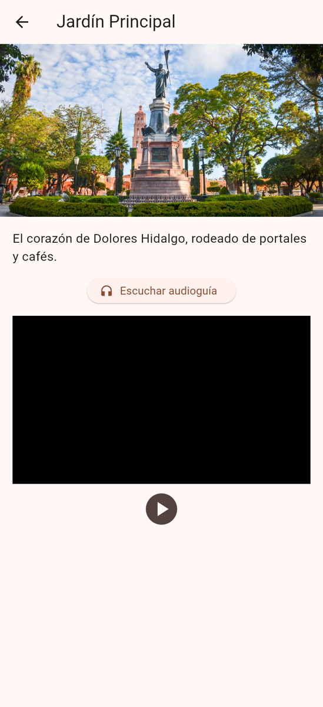
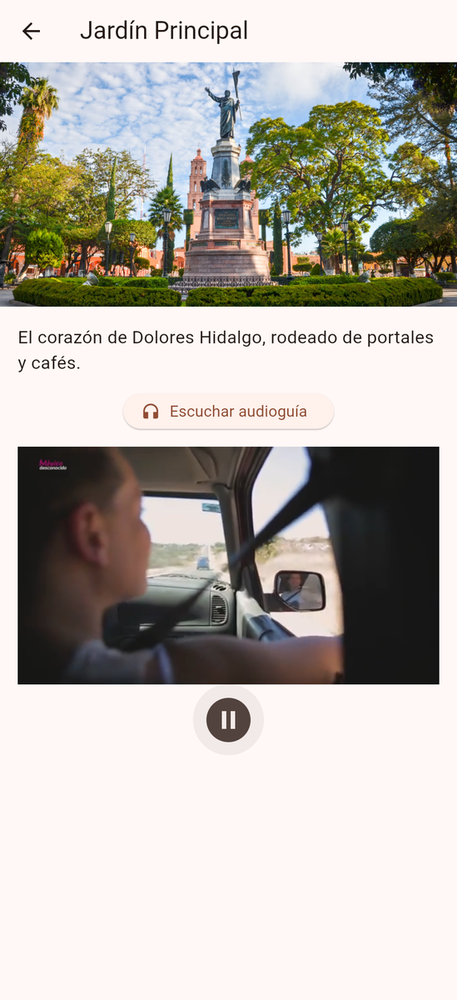

# Descubre Dolores Hidalgo

App en **Flutter** que muestra lugares turísticos de Dolores Hidalgo, Guanajuato, con foto, descripción, **audioguía** y **video**. El proyecto está organizado con **Arquitectura Limpia** (Clean Architecture) en tres capas: datos, dominio y presentación.

| | |
|---|---|
| **Alumno** | Cristopher Gerardo Villanueva Ramírez |
| **Materia** | Desarrollo de Aplicaciones Móviles |
| **Tarea** | 3 · Arquitectura limpia |

## Capturas de pantalla

<table>
  <tr><td align="center"><br><sub>Lista de lugares</sub></td><td align="center"><br><sub>Detalle: Jardín Principal</sub></td><td align="center"><br><sub>Video reproduciéndose</sub></td></tr>
  <tr><td align="center"><br><sub>Detalle: Parroquia</sub></td><td align="center"><br><sub>Detalle: Museo Casa de Hidalgo</sub></td></tr>
</table>

## Funcionalidades

- Lista de lugares turísticos con imagen miniatura y descripción corta.
- Pantalla de detalle con foto grande y descripción completa.
- Botón **Escuchar audioguía** (paquete `audioplayers`).
- Reproductor de **video** con botón de reproducir y pausar (paquete `video_player`).

## Arquitectura

```
lib/
├── main.dart                         # Composition root: conecta las capas
├── data/
│   ├── datasources/lugares_local_datasource.dart
│   └── repositories/lugares_repository_impl.dart
├── domain/
│   ├── entities/lugar_turistico.dart
│   ├── repositories/lugares_repository.dart
│   └── usecases/obtener_lugares.dart · obtener_lugar_por_id.dart
└── presentation/
    ├── viewmodels/lugares_view_model.dart · detalle_view_model.dart
    └── views/lista_lugares_screen.dart · detalle_lugar_screen.dart · widgets/
```

- **Dominio:** entidades y casos de uso; no depende de Flutter ni de la capa de datos.
- **Datos:** fuente de datos local y la implementación del repositorio.
- **Presentación:** pantallas y *ViewModels* que llaman a los casos de uso.

Los recursos (imágenes, audios y video) están en `assets/`.

## Cómo ejecutar

```bash
flutter pub get
flutter run
```
